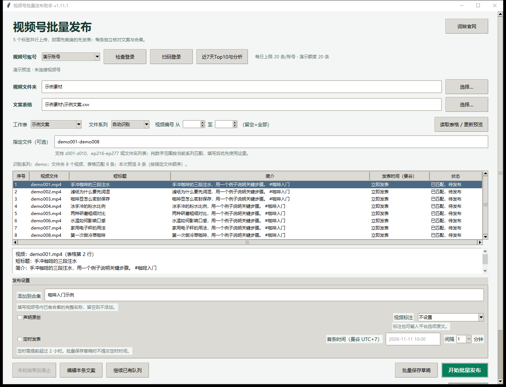

# 微信视频号批量发布助手 · Windows 桌面版

在 Windows 上从 Excel / CSV 导入文案，批量上传和定时发布微信视频号视频，核对后台发布结果，并生成近 7 天播放 Top10 分析报告。

<a href="https://github.com/itai365com-pixel/wechat-channels-publisher-windows/releases/download/v1.11.1/wechat-channels-publisher-windows-v1.11.1-x64.exe"></a>

适用于 Windows 10 / 11 x64。[版本说明与校验文件](https://github.com/itai365com-pixel/wechat-channels-publisher-windows/releases/tag/v1.11.1)

<a href="docs/screenshots/batch-publishing.png"></a> <a href="docs/screenshots/top10-analysis.png"></a>

左图为批量发布界面，右图为 Top10 分析报告。两张截图均使用虚构的示例数据，点击可查看原图。

安装包内含 Python 和 Chromium。安装可以离线进行，扫码登录、发布和读取统计需要联网。

## 开始使用

1. 下载并运行 Releases 里的 `.exe`，从开始菜单打开「视频号批量发布助手」。单条发布也有单独入口。
2. 选择本地账号并用微信扫码登录。
3. 选择视频文件夹和文案表格，点击「读取表格 / 更新预览」。支持 `.xlsx`、`.csv` 和 `.tsv`。
4. 在预览里核对文件名、短标题和简介。可以输入 `ep001-ep010` 选择一段连续编号的视频。
5. 设置合集、原创声明、视频标注和发表时间，核对后提交。发布结果以视频号后台核验为准。

安装目录中有一份示例文案表，也可使用下面的格式。简介里的 `#话题` 会原样填写。

```csv
文件名,短标题,简介
ep001.mp4,示例短标题,这里填写视频简介 #话题
ep002.mp4,第二条短标题,这里填写第二条视频简介
```

## 批量发布和内容分析

- 支持最多 5 个标签并行上传。封面先就绪的作品优先提交，每次提交一条。
- 可保存草稿、立即发表或定时发表。批次间隔可设为 1、3、5 分钟，时间按曼谷时区填写。
- 单个本地账号每天最多提交 20 条，按曼谷日期计算。草稿不计入；提交结果未知时保留额度，并先核对后台再处理。
- 点击「近7天Top10与分析」读取最近 7 个自然日内发表的作品，按读取时的累计播放量排名。工具只为入榜作品读取详情，生成包含完播、平均观看、留存采样、播放来源和优化建议的本地 HTML 报告。
- 「词映官网」按钮可打开 [词映](https://www.tugei.com/)。

## 数据存放位置

扫码会话保存在安装目录的 `cookies/`，队列、额度和报告保存在 `.local/gui/`。更换电脑后需要重新扫码，并重新选择素材和表格路径。公开仓库和安装包只包含程序与示例，实际账号、素材和发布记录留在本机。

## 从源码运行和构建

在 Windows x64 上安装 Python 3.12，打开 PowerShell 并进入仓库目录。

```powershell
py -3.12 -m venv .venv
.\.venv\Scripts\python.exe -m pip install -r requirements-windows.txt
$env:PLAYWRIGHT_BROWSERS_PATH = Join-Path (Get-Location) '.local\browsers'
.\.venv\Scripts\python.exe -m patchright install chromium
.\.venv\Scripts\python.exe desktop_launcher.pyw
```

启动单条版时，在最后一条命令后添加 `--single`。如需编译离线安装包，先安装 Inno Setup，再把 `--compiler` 指向本机的 `ISCC.exe`。安装包输出到 `dist/Windows/`。

```powershell
.\.venv\Scripts\python.exe packaging\windows\build_installer.py --compiler 'C:\path\to\ISCC.exe'
```

## 上游与许可

本项目基于 [dreammis/social-auto-upload](https://github.com/dreammis/social-auto-upload) 的源码，加入 Windows 桌面发布界面、批量队列和数据分析。上游源码基线为 [`3847fff`](https://github.com/dreammis/social-auto-upload/commit/3847fff01f5434a8a32829833163cd6723cabc59)。

原项目版权为 Copyright (c) 2023 dreammis。项目使用 [MIT 许可证](LICENSE)，安装包中的第三方组件附有各自的许可。此项目是非官方辅助工具，与微信或腾讯无隶属关系。
