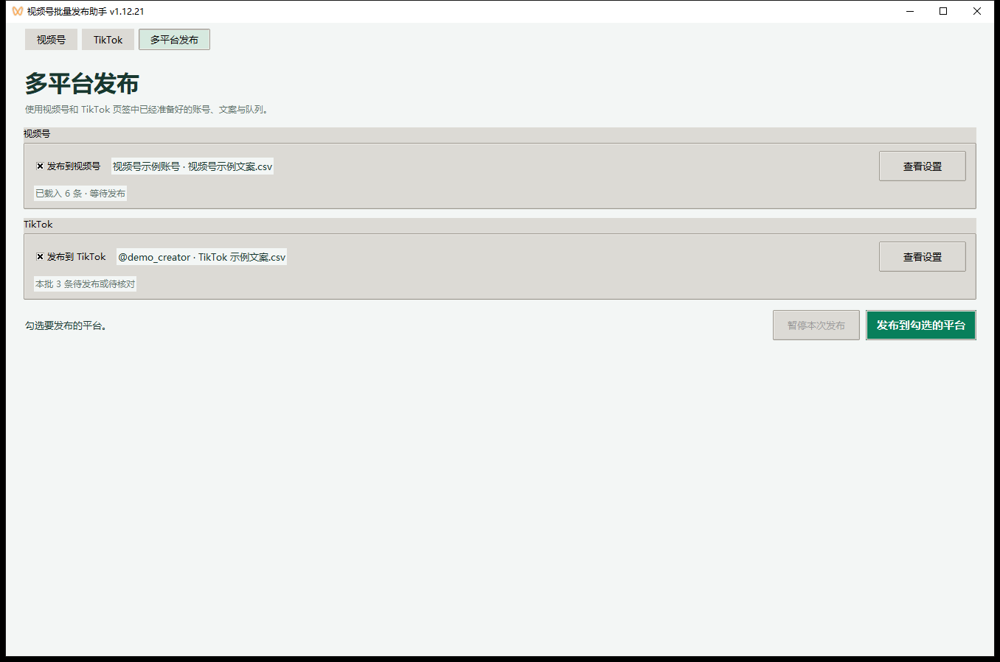
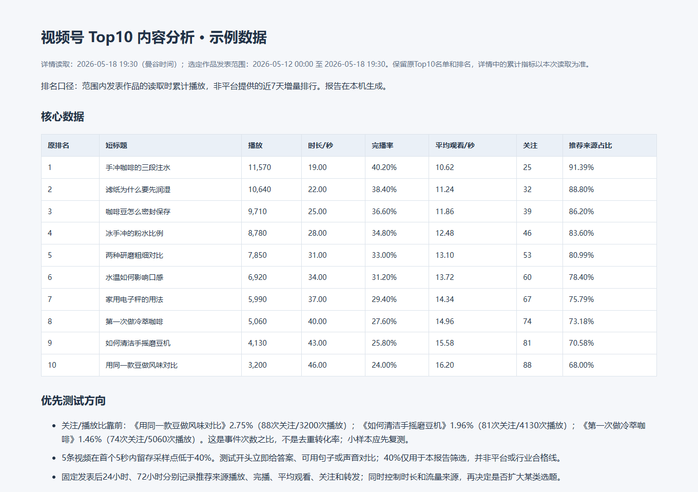
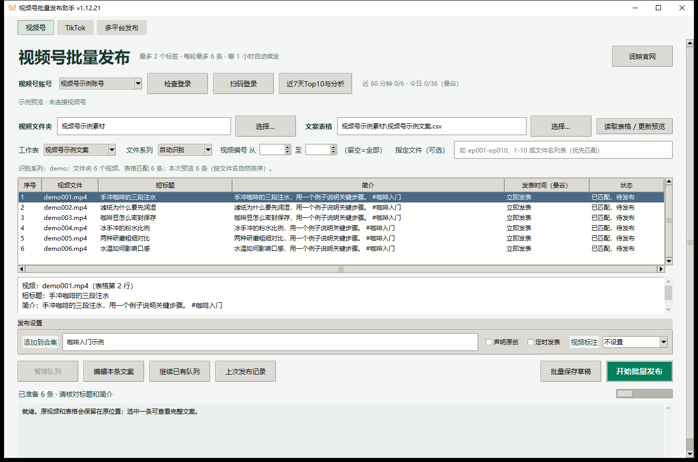
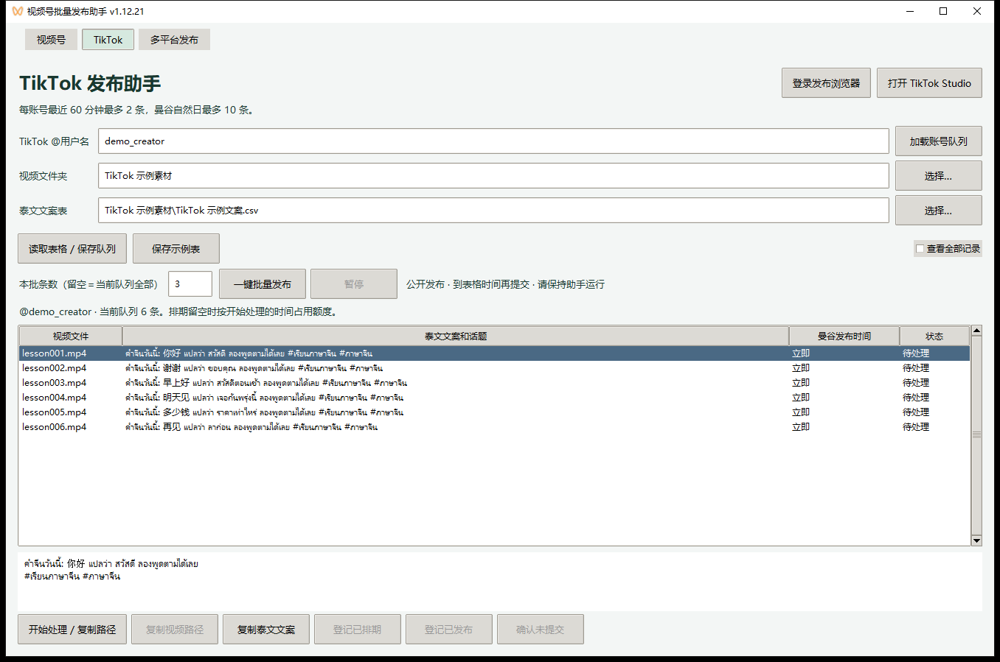

# 微信视频号批量发布工具 · Windows 桌面版

**WeChat Channels & TikTok Batch Publisher for Windows**

这是一款免费开源的 **微信视频号批量发布工具**，适用于 Windows 10 / 11。支持 Excel / CSV 文案导入、批量上传、定时发表、断点续发、发布去重和近 7 天播放 Top10 分析，也支持通过 TikTok Studio 批量发布。

<a href="https://github.com/itai365com-pixel/wechat-channels-publisher-windows/releases/download/v1.12.21/wechat-channels-publisher-windows-v1.12.21-x64.exe"></a>

[免费下载 v1.12.21 Windows 安装包](https://github.com/itai365com-pixel/wechat-channels-publisher-windows/releases/download/v1.12.21/wechat-channels-publisher-windows-v1.12.21-x64.exe) · [版本说明与 SHA256 校验](https://github.com/itai365com-pixel/wechat-channels-publisher-windows/releases/tag/v1.12.21) · [中文更新日志](CHANGELOG.md)

[项目主页](https://itai365com-pixel.github.io/wechat-channels-publisher-windows/) · [视频号使用指南](#如何批量发布视频号视频) · [TikTok 使用指南](#tiktok-批量发布) · [多平台发布](#从一个页面启动多平台发布)

**多平台发布：** 在「视频号」和「TikTok」页分别配置账号、素材、文案和发布时间。切到「多平台发布」，勾选要发的平台，点击「发布到勾选的平台」。勾选两个平台时，两边按各自设置并行发布。

<a href="docs/screenshots/multiplatform-v1.12.21.png"></a> <a href="docs/screenshots/top10-analysis.png"></a>

左图为多平台发布，右图为视频号 Top10 分析。截图均使用示例数据，点击可查看原图。

离线安装包内置 Python 和视频号使用的 Chromium。使用 TikTok 发布需安装 Google Chrome。登录、发布和读取统计时需要联网。

## 适用场景

- **课程、教程和连载视频**：用表格为每条作品准备不同的短标题、简介和话题，按文件编号选择本次发布范围。
- **集中准备、分批更新**：统一设置合集、原创声明和视频标注，选择立即发表、定时发表或批量保存草稿。
- **视频号内容复盘**：核对哪些作品已经发表，查看近 7 天新发作品中累计播放量最高的 10 条。

## 如何批量发布视频号视频

<a href="docs/screenshots/batch-publishing-v1.12.21.png"></a>

1. 下载并运行 Releases 里的 `.exe`，从开始菜单打开「视频号批量发布助手」。单条发布也有单独入口。
2. 选择本地账号并用微信扫码登录。
3. 选择视频文件夹和文案表格，点击「读取表格 / 更新预览」。支持 `.xlsx`、`.csv` 和 `.tsv`。
4. 在预览里核对文件名、短标题和简介。可以输入 `ep001-ep010` 选择一段连续编号的视频。
5. 设置合集、原创声明、视频标注和发表时间，核对后提交。发布结果以视频号后台核验为准。

安装目录中有一份示例文案表，也可使用下面的格式。简介里的 `#话题` 会原样填写。

```csv
文件名,短标题,简介
ep001.mp4,示例短标题,这里填写视频简介 #话题
ep002.mp4,第二条短标题,这里填写第二条视频简介
```

## 视频号批量上传与 Excel / CSV 文案

- 自动恢复上次使用的视频文件夹、文案表格和工作表。两个「选择」窗口分别记住各自的目录。
- 短标题中的中文、英文逗号在预览或保存编辑时替换为空格，简介和表格原文会保留。
- 支持最多 2 个标签并行上传。封面先就绪的作品优先提交，每次提交一条。

## 视频号定时发布与分轮续发

- 可保存草稿、立即发表或定时发表。平台定时发表的作品间隔可选 1、3、5 分钟，时间按曼谷时区填写。
- 单个本地账号最近 60 分钟最多提交 6 条，每个曼谷自然日最多提交 36 条。草稿不计入额度，结果未知的提交保留额度。
- 批次每轮最多 6 条，轮次结束后至少等 1 小时再继续。达到当天额度时，等曼谷时间次日且满足轮间等待后自动续发。等待期间可最小化窗口，请保持电脑和程序运行。
- 平台定时发表仍使用预览时间，错过提交时间时暂停并提示检查。

## 发布记录、断点续发和已发布去重

- 「上次发布记录」显示当前账号最近一次批次的作品及核验状态。新建或继续队列时，按本地视频指纹跳过已核验发表的作品。
- 点击「暂停队列」后，已开始的条目结束即暂停。重新打开程序时，可通过「继续已有队列」恢复原队列及轮间等待。

## 视频号数据分析与近 7 天播放 Top10

点击「近7天Top10与分析」读取最近 7 个曼谷自然日内发表的作品，按读取时的累计播放量排名。工具只为入榜作品读取详情，生成包含完播、平均观看、留存采样、播放来源和选题建议的本地 HTML 报告。后台缺失的指标会标为「未提供」。

## TikTok 批量发布

<a href="docs/screenshots/tiktok-batch-publishing-v1.12.21.png"></a>

1. 在批量发布助手顶部切换到「TikTok」，填写 TikTok Studio 显示的 `@用户名`。
2. 选择视频目录和 Excel（`.xlsx`）、CSV 或 TSV 文案表，点击「读取表格 / 保存队列」。必填列为「视频文件名」和「TikTok 文案」（也可用「泰文文案」），「话题」与「曼谷发布时间」可选。
3. 首次点击「登录发布浏览器」，在打开的 Google Chrome 窗口登录同一账号。发布浏览器的登录会话和队列按账号保存在本机。
4. 核对视频与文案，填写本批条数或留空处理全部待处理项，再点「一键批量发布」。工具按队列逐条提交，并在 TikTok Studio 作品列表核验公开状态。

```csv
视频文件名,TikTok 文案,话题,曼谷发布时间
lesson001.mp4,คำจีนวันนี้: 你好 แปลว่า สวัสดี,#เรียนภาษาจีน,
lesson002.mp4,คำจีนวันนี้: 谢谢 แปลว่า ขอบคุณ,#เรียนภาษาจีน,
```

- 填写「曼谷发布时间」时使用文本格式 `YYYY-MM-DD HH:MM`。助手在电脑上等到时间再提交，等待期间请保持软件运行。
- 助手默认每个 TikTok 账号最近 60 分钟最多提交 2 条，每个曼谷自然日最多 10 条。达到额度后等待下一时段。
- 队列按账号和视频内容识别已登记的作品。提交结果未知时会先核对后台再决定下一步。也可手动在 Studio 排期，核对后在队列里登记。

## 从一个页面启动多平台发布

v1.12.21 的「多平台发布」直接使用各平台页已经准备好的队列：

1. 在「视频号」页选账号、素材和文案，更新预览并核对发布设置。
2. 在「TikTok」页加载账号队列或导入表格，按需设置本批条数。
3. 切到「多平台发布」，核对两边的账号与队列，勾选需要发布的平台并启动。

两个平台可以使用不同的素材、文案和发布时间。勾选两边时，两条队列并行运行，各自遵守原有额度、核验和去重规则。

## 常见问题

### 视频号定时发布需要提前多久？

平台定时发表的首条时间需比当前时间提前超过 2 小时。作品间隔与工具的分轮等待分别设置。

### 重启或换电脑后，如何避免重复发布？

保留本地队列和发布历史。同一账号下，有已核验记录的相同视频内容会被跳过。发表结果待核对的条目，请先在视频号后台确认，再决定是否重试。换电脑时，先核对旧电脑的发布记录和素材路径。

### 上传失败后还能继续批量发布吗？

先查看日志中显示的文件和失败原因。若旧队列的短标题需要修改，可重新读取表格、核对或编辑预览，只选尚未提交的作品新建队列。其他提交前失败可在解决原因后通过「继续已有队列」重试。

## 数据存放位置

视频号扫码会话保存在安装目录的 `cookies/`，队列、额度和报告保存在 `.local/gui/`。TikTok 队列和发布浏览器会话保存在 `.local/gui/tiktok/`。换电脑后需重新登录，并重新选择素材和表格。公开仓库和安装包只包含程序与示例。

「词映官网」按钮可打开 [词映](https://www.tugei.com/)。

## 从源码运行和构建

在 Windows x64 上安装 Python 3.12，打开 PowerShell 并进入仓库目录。

```powershell
py -3.12 -m venv .venv
.\.venv\Scripts\python.exe -m pip install -r requirements-windows.txt
$env:PLAYWRIGHT_BROWSERS_PATH = Join-Path (Get-Location) '.local\browsers'
.\.venv\Scripts\python.exe -m patchright install chromium
.\.venv\Scripts\python.exe desktop_launcher.pyw
```

启动单条版时，在最后一条命令后添加 `--single`。如需编译离线安装包，先安装 Inno Setup，再把 `--compiler` 指向本机的 `ISCC.exe`。安装包输出到 `dist/Windows/`。

```powershell
.\.venv\Scripts\python.exe packaging\windows\build_installer.py --compiler 'C:\path\to\ISCC.exe'
```

## 上游与许可

本项目基于 [dreammis/social-auto-upload](https://github.com/dreammis/social-auto-upload) 的源码，加入 Windows 桌面发布界面、视频号和 TikTok 批量队列及视频号数据分析。上游源码基线为 [`3847fff`](https://github.com/dreammis/social-auto-upload/commit/3847fff01f5434a8a32829833163cd6723cabc59)。

原项目版权为 Copyright (c) 2023 dreammis。项目使用 [MIT 许可证](LICENSE)，安装包中的第三方组件附有各自的许可。此项目是非官方辅助工具，与微信、腾讯或 TikTok 无隶属关系。
